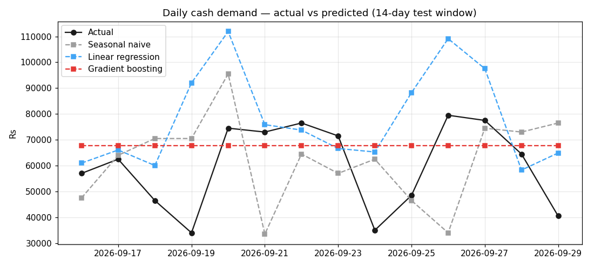
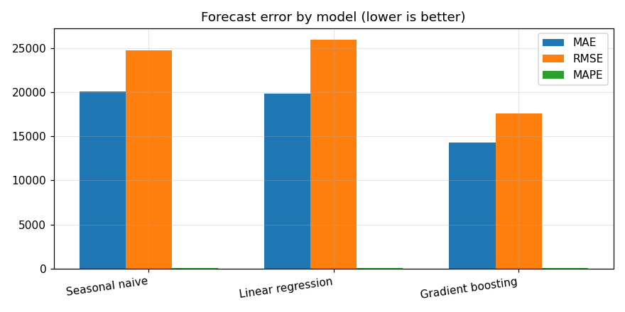
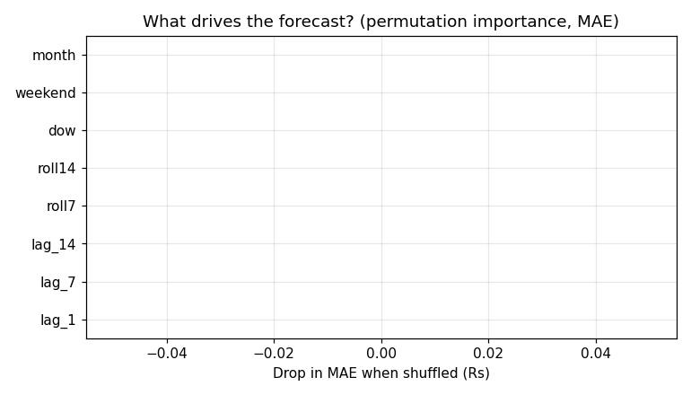
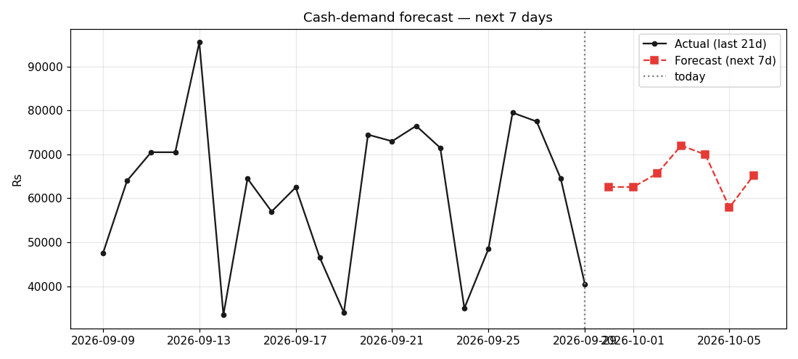

# ATM Cash-Demand Forecasting (Predictive Analysis · scikit-learn)

Can we predict tomorrow's cash demand across the ATM fleet — so cash is
loaded *before* machines run dry? This project turns the 2,290 cleaned
transactions from the [SQL data-quality audit](../atm-data-quality-sql)
into a daily demand series and benchmarks three forecasting approaches.

## The question

> Given the last 60 days of withdrawals, predict daily cash outflow for
> the next 14 days — and produce a rolling 7-day forecast a cash-management
> team could actually use.

## Method

1. **Target:** daily total of successful `CASH_WITHDRAWAL` amounts
   (60 days, Rs 3.91M total, mean Rs 65,233/day).
2. **Features:** lag_1, lag_7, lag_14, 7/14-day rolling means, day-of-week,
   weekend flag, month — no leakage (all features shift-1 or calendar-only).
3. **Split:** time-based — first 32 usable days train, last 14 days test.
4. **Models:** seasonal-naive baseline (same weekday last week) vs linear
   regression vs gradient boosting (HistGradientBoostingRegressor).

## Results (14-day test window)

| Model | MAE (Rs) | RMSE (Rs) | MAPE |
|---|---|---|---|
| Seasonal naive | 20,071 | 24,733 | 39% |
| Linear regression | 19,807 | 25,951 | 41% |
| **Gradient boosting** | **14,250** | **17,580** | **31%** |

Gradient boosting cut the baseline error by **~29% (MAE)**. The biggest
drivers are the recent lags and rolling averages — demand momentum matters
more than the calendar alone. The model then refits on all 60 days and
produces a recursive 7-day forecast (see `forecast_next7.csv`).






## Honest caveats

- The source data is **simulated** (patterned on real cash-management
  behaviour, not real bank data).
- 60 days is a short series — a production forecaster would want 12+ months
  to capture salary-cycle and festival seasonality; MAPE would tighten with
  more history.
- This is a demand-level forecast for the whole fleet; per-ATM forecasts
  would need per-machine series.

## Run it

```bash
python3 forecast.py   # metrics + all charts + forecast CSV
```

## Files

- `forecast.py` — full pipeline: features → models → metrics → charts → forecast
- `model_metrics.csv` — MAE/RMSE/MAPE per model
- `forecast_next7.csv` — the recursive 7-day forecast
- `charts/` — the four output charts (PNG)

Part of the [data-analyst-projects](../) series:
`atm-data-quality-sql` (SQL audit) → `atm-cash-demand-eda` (descriptive) →
**this project** (predictive).
